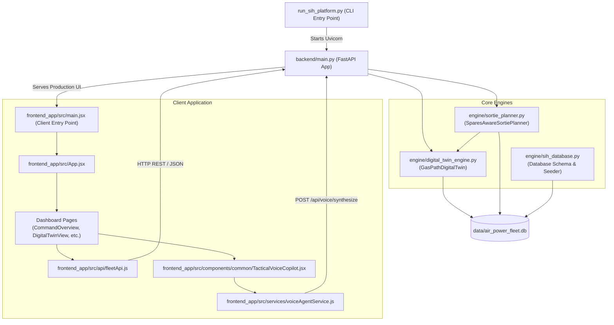
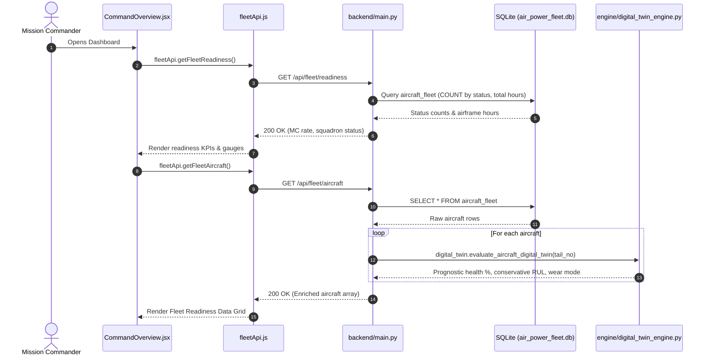
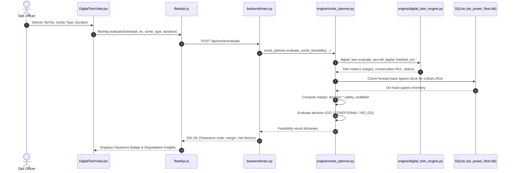
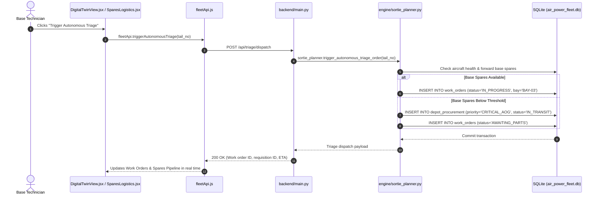
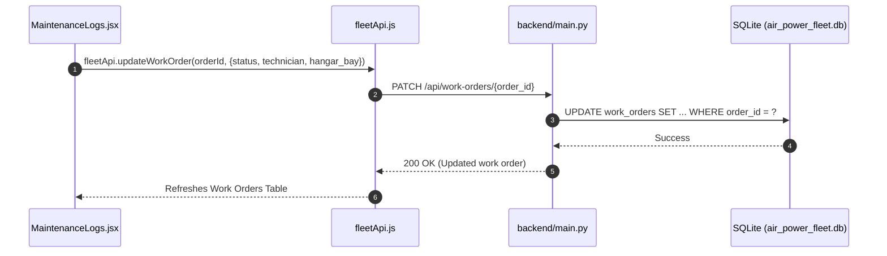
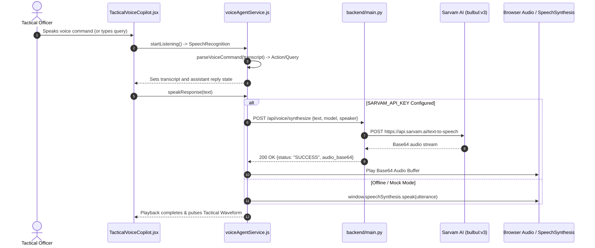

# Code Execution & Data Flow Architecture (`flow.md`)

This document details how execution moves between files in the **Air Power Fleet Availability Platform**, specifying entry points, order of execution, call graphs, and inter-module function calls.

---

## 1. High-Level Architecture Overview



---

## 2. System Entry Points

### 2.1 Backend Entry Point: `run_sih_platform.py`
* **File**: [`run_sih_platform.py`](file:///C:/Users/shiv7/OneDrive/Documents/Desktop/vayu-ai/run_sih_platform.py)
* **Execution Trigger**: `python run_sih_platform.py`
* **Execution Order**:
  1. Resolves `BASE_DIR` and `ROOT_DIR` paths and prepends them to `sys.path`.
  2. Resolves path to database `data/air_power_fleet.db`.
  3. Outputs system header and operational endpoint links to standard output.
  4. Imports `app` from `backend.main`.
  5. Invokes `uvicorn.run(app, host="127.0.0.1", port=8000, log_level="info")`.

---

### 2.2 Backend Application Entry Point: `backend/main.py`
* **File**: [`backend/main.py`](file:///C:/Users/shiv7/OneDrive/Documents/Desktop/vayu-ai/backend/main.py)
* **Execution Trigger**: Imported by Uvicorn.
* **Execution Order**:
  1. **Imports & Environment Configuration**: Configures paths, imports FastAPI, Pydantic, and SQLite.
  2. **Engine Instantiation**:
     * Instantiates `digital_twin = GasPathDigitalTwin(db_path=DB_PATH)`
     * Instantiates `sortie_planner = SparesAwareSortiePlanner(db_path=DB_PATH)`
  3. **Middleware Setup**: Configures `CORSMiddleware` with open origins for local development.
  4. **Static Asset Mounting**: Mounts `/assets` from `frontend_app/dist/assets` if built.
  5. **Endpoint Route Registration**: Registers REST controllers for fleet readiness, digital twin, sortie planner, logistics, work orders, flight logs, and voice synthesis.

---

### 2.3 Database Initialization & Seeding Entry Point: `engine/sih_database.py`
* **File**: [`engine/sih_database.py`](file:///C:/Users/shiv7/OneDrive/Documents/Desktop/vayu-ai/engine/sih_database.py)
* **Execution Trigger**: Can be run directly (`python engine/sih_database.py`) or called programmatically.
* **Function Flow**:
  1. `init_db(db_path)`:
     * Connects to SQLite and creates tables:
       * `aircraft_fleet` (Master tail registry)
       * `telemetry_snapshots` (NASA C-MAPSS mapped sensor data)
       * `flight_logs` (Historical mission hours and debriefs)
       * `base_spares_inventory` (Forward base LRU stock)
       * `depot_procurement` (Supply chain pipeline and transit tracking)
       * `work_orders` (Autonomous maintenance orders)
  2. `seed_fleet_data(conn)`: Populates master IAF squadrons (e.g., No. 222 Tigersharks, No. 45 Flying Daggers).
  3. `seed_telemetry(conn)`: Ingests C-MAPSS sensor cycles.
  4. `seed_spares_and_procurement(conn)`: Populates base LRU stock and active requisitions.

---

### 2.4 Frontend Entry Point: `frontend_app/src/main.jsx`
* **File**: [`frontend_app/src/main.jsx`](file:///C:/Users/shiv7/OneDrive/Documents/Desktop/vayu-ai/frontend_app/src/main.jsx)
* **Execution Trigger**: Browser visits `http://127.0.0.1:8000/dashboard` or `http://localhost:5173`.
* **Execution Order**:
  1. Imports React DOM, global styles (`index.css`), and the root [`App`](file:///C:/Users/shiv7/OneDrive/Documents/Desktop/vayu-ai/frontend_app/src/App.jsx).
  2. Mounts `<App />` inside `#root` under `React.StrictMode`.
  3. In `App.jsx`, initializes `<ThemeProvider>` from `context/ThemeContext.jsx`.
  4. Mounts layout components:
     * [`Sidebar.jsx`](file:///C:/Users/shiv7/OneDrive/Documents/Desktop/vayu-ai/frontend_app/src/components/layout/Sidebar.jsx): Navigation menu and tab selection.
     * [`Navbar.jsx`](file:///C:/Users/shiv7/OneDrive/Documents/Desktop/vayu-ai/frontend_app/src/components/layout/Navbar.jsx): Breadcrumbs, system clock, tactical voice toggle, and status badge.
     * [`TacticalVoiceCopilot.jsx`](file:///C:/Users/shiv7/OneDrive/Documents/Desktop/vayu-ai/frontend_app/src/components/common/TacticalVoiceCopilot.jsx): Floating conversational AI assistant.
     * Active page component determined by `activeTab`.

---

## 3. Detailed Runtime Function Call Flows

### 3.1 Fleet Readiness & Status Overview Flow



* **Step-by-Step Code Path**:
  1. `CommandOverview.jsx` executes `useEffect()` on mount and triggers `loadData()`.
  2. `fleetApi.getFleetReadiness()` sends an HTTP GET request via `fetchWithTimeout()` to `/api/fleet/readiness`.
  3. FastAPI endpoint `get_fleet_readiness()` in `backend/main.py`:
     - Calls `get_db_connection()`.
     - Executes SQL `GROUP BY status` to calculate total vs capable aircraft.
     - Calculates Mission Capable rate: `mc_rate = (capable / total) * 100`.
     - Fetches active procurement counts from `depot_procurement`.
  4. `fleetApi.getFleetAircraft()` calls `/api/fleet/aircraft`.
  5. Endpoint `list_fleet_aircraft()` loops over all registered aircraft and calls:
     - `digital_twin.evaluate_aircraft_digital_twin(r["tail_no"])`
     - Attaches `health_score`, `rul_hours`, `conservative_rul_hours`, and `next_fault`.

---

### 3.2 Sortie Feasibility & Clearance Flow



* **Step-by-Step Code Path**:
  1. User triggers mission evaluation from `DigitalTwinView.jsx`.
  2. `fleetApi.evaluateSortie(tailNo, sortieType, durationHours)` sends payload to `POST /api/sortie/evaluate`.
  3. `backend/main.py:evaluate_sortie(req: SortieEvaluationRequest)` delegates execution to:
     `sortie_planner.evaluate_sortie_feasibility(req.tail_no, req.sortie_type, req.duration_hours)`.
  4. In `engine/sortie_planner.py`:
     - `self.digital_twin.evaluate_aircraft_digital_twin(tail_no)` retrieves the latest 5-stage health metrics and conservative RUL.
     - Looks up mission safety multiplier (e.g., CAP = 1.6x, Reconnaissance = 1.3x).
     - Checks if `conservative_rul_hours < required_margin_hours`.
     - Queries `base_spares_inventory` via SQLite to check if spares for degraded stages exist at the base.
     - Assigns clearance status:
       - `GO`: Sufficient RUL and healthy subsystems.
       - `CONDITIONAL_GO`: Minor wear or sensor drift detected; flight permitted with tactical constraints.
       - `NO_GO`: Airframe grounded or insufficient RUL margin.

---

### 3.3 Autonomous Triage & Work Order Requisition Flow



---

### 3.4 Work Order Modification Flow



---

### 3.5 Vayu-AI Tactical Voice Agent & Synthesis Flow



* **Step-by-Step Code Path**:
  1. Triggered via the microphone button in [`TacticalVoiceCopilot.jsx`](file:///C:/Users/shiv7/OneDrive/Documents/Desktop/vayu-ai/frontend_app/src/components/common/TacticalVoiceCopilot.jsx) or [`Navbar.jsx`](file:///C:/Users/shiv7/OneDrive/Documents/Desktop/vayu-ai/frontend_app/src/components/layout/Navbar.jsx).
  2. [`voiceAgentService.js`](file:///C:/Users/shiv7/OneDrive/Documents/Desktop/vayu-ai/frontend_app/src/services/voiceAgentService.js) listens using `webkitSpeechRecognition` or `SpeechRecognition`.
  3. Matches regex rules against fleet operations:
     - Readiness queries (`"fleet status"`, `"mission capable rate"`)
     - Specific aircraft health checks (`"inspect SB-021"`, `"check health"`)
     - Grounded airframes & triage orders (`"show grounded"`, `"dispatch work order"`)
     - Spares & inventory inquiries (`"spares stock"`, `"depot pipeline"`)
  4. Audio playback:
     - If backend endpoint `/api/voice/synthesize` returns `audio_base64`, it is decoded into a `Blob` and played via an `Audio` element.
     - If backend returns `{status: "MOCK"}` or fails, it cleanly falls back to the native `window.speechSynthesis` API.

---

## 4. Frontend Component & Context Hierarchy

```text
frontend_app/src/main.jsx
└── App.jsx
    └── ThemeProvider (context/ThemeContext.jsx)
        ├── Sidebar.jsx (Navigation state & tab switching)
        ├── Navbar.jsx (Theme toggle, live status indicator, voice copilot trigger, docs modal)
        ├── DocsModal.jsx (Platform architecture & documentation dialog)
        ├── TacticalVoiceCopilot.jsx (Floating AI Voice assistant & waveform visualizer)
        └── Dynamic View:
            ├── CommandOverview.jsx (KPI cards, Squadron readiness, Quick actions)
            ├── DigitalTwinView.jsx (5-Stage Gas Path, Sortie Simulator, Interactive Triage)
            │   └── TurbofanEngineSchematic.jsx (Interactive SVG Gas-Path diagram)
            ├── PredictiveAnalytics.jsx (C-MAPSS degradation curves, Sensor correlation)
            ├── SparesLogistics.jsx (Base LRU inventory, Depot transit tracking)
            └── MaintenanceLogs.jsx (Work orders, Flight history, Technician assignment)
```

---

## 5. File-by-File Cross-Reference Index

| File Path | Role | Key Functions / Classes | Downstream Dependencies |
| :--- | :--- | :--- | :--- |
| [`run_sih_platform.py`](file:///C:/Users/shiv7/OneDrive/Documents/Desktop/vayu-ai/run_sih_platform.py) | CLI Launcher | `main` | [`backend/main.py`](file:///C:/Users/shiv7/OneDrive/Documents/Desktop/vayu-ai/backend/main.py) |
| [`backend/main.py`](file:///C:/Users/shiv7/OneDrive/Documents/Desktop/vayu-ai/backend/main.py) | REST API Controller | `get_fleet_readiness`, `list_fleet_aircraft`, `evaluate_sortie`, `dispatch_triage`, `synthesize_voice` | [`engine/digital_twin_engine.py`](file:///C:/Users/shiv7/OneDrive/Documents/Desktop/vayu-ai/engine/digital_twin_engine.py), [`engine/sortie_planner.py`](file:///C:/Users/shiv7/OneDrive/Documents/Desktop/vayu-ai/engine/sortie_planner.py), Sarvam AI |
| [`engine/digital_twin_engine.py`](file:///C:/Users/shiv7/OneDrive/Documents/Desktop/vayu-ai/engine/digital_twin_engine.py) | Thermodynamics & Prognostics | `GasPathDigitalTwin`, `evaluate_aircraft_digital_twin`, `calculate_gas_path_efficiencies` | `data/air_power_fleet.db`, `data/CMAPSSData/` |
| [`engine/sortie_planner.py`](file:///C:/Users/shiv7/OneDrive/Documents/Desktop/vayu-ai/engine/sortie_planner.py) | Mission & Triage Engine | `SparesAwareSortiePlanner`, `evaluate_sortie_feasibility`, `trigger_autonomous_triage_order` | [`engine/digital_twin_engine.py`](file:///C:/Users/shiv7/OneDrive/Documents/Desktop/vayu-ai/engine/digital_twin_engine.py), `data/air_power_fleet.db` |
| [`engine/sih_database.py`](file:///C:/Users/shiv7/OneDrive/Documents/Desktop/vayu-ai/engine/sih_database.py) | Database Schema & Seeder | `init_db`, `seed_fleet_data`, `seed_telemetry`, `seed_spares_and_procurement` | `sqlite3`, `data/air_power_fleet.db` |
| [`frontend_app/src/main.jsx`](file:///C:/Users/shiv7/OneDrive/Documents/Desktop/vayu-ai/frontend_app/src/main.jsx) | React Application Root | DOM Mount | [`frontend_app/src/App.jsx`](file:///C:/Users/shiv7/OneDrive/Documents/Desktop/vayu-ai/frontend_app/src/App.jsx) |
| [`frontend_app/src/api/fleetApi.js`](file:///C:/Users/shiv7/OneDrive/Documents/Desktop/vayu-ai/frontend_app/src/api/fleetApi.js) | Frontend REST Client | `fleetApi`, `getFleetReadiness`, `getFleetAircraft`, `evaluateSortie`, `triggerAutonomousTriage` | [`backend/main.py`](file:///C:/Users/shiv7/OneDrive/Documents/Desktop/vayu-ai/backend/main.py), `mockFleetData.js` |
| [`frontend_app/src/services/voiceAgentService.js`](file:///C:/Users/shiv7/OneDrive/Documents/Desktop/vayu-ai/frontend_app/src/services/voiceAgentService.js) | Voice Agent Logic | `VoiceAgentService`, `parseVoiceCommand`, `speakResponse` | `SpeechRecognition`, `speechSynthesis`, `backend/main.py` |
| [`frontend_app/src/components/common/TacticalVoiceCopilot.jsx`](file:///C:/Users/shiv7/OneDrive/Documents/Desktop/vayu-ai/frontend_app/src/components/common/TacticalVoiceCopilot.jsx) | Voice Assistant UI | Tactical UI modal, real-time waveform, action dispatcher | `voiceAgentService.js`, `ThemeContext.jsx` |
| [`frontend_app/src/context/ThemeContext.jsx`](file:///C:/Users/shiv7/OneDrive/Documents/Desktop/vayu-ai/frontend_app/src/context/ThemeContext.jsx) | Global State Context | `ThemeProvider`, `useTheme` | All React UI pages and components |
